# Tilt Racer — Motion Steering Proof of Concept

**Status:** Browser-based demonstration  
**Platform:** Laptop browser + Android phone running nikki Streams  
**Implementation:** HTML Canvas, JavaScript modules, WebSocket sensor stream

## Abstract

Tilt Racer demonstrates phone-as-steering-wheel control for a small top-down racing game. The phone streams motion sensor readings through nikki Streams. The laptop browser reads Orientation data, captures a neutral position, filters small movements, and maps the relative tilt to the player's horizontal position. Traffic, collision detection, and scoring run locally in the browser.

The prototype is intentionally small: it demonstrates the complete sensor-to-game path without a game engine, backend, or raw motion recording.

## Demonstration goals

- Connect the game to a phone's nikki Streams session over the local network.
- Use Orientation to steer with a comfortable, calibrated phone tilt.
- Smooth sensor noise and ignore small hand tremors.
- Return steering toward center if sensor data becomes stale.
- Keep the game playable with keyboard controls when a phone is unavailable.

## Requirements

- A laptop with a modern browser and this repository.
- An Android phone with nikki Streams installed.
- Both devices connected to the same Wi-Fi network or phone hotspot.
- The Streams server address and session ID for the active phone session.
- A local HTTP server to serve the page and its JavaScript module.

## Sensor setup

In nikki Streams, enable **Orientation**, **Gyroscope**, and **Game Rotation Vector**, then start streaming. Orientation is the steering input. Gyroscope and Game Rotation Vector are shown for diagnostics only until their axes have been verified with controlled tilts. Other sensors, including Ambient Light, can remain off.

The current parser expects an Orientation vector in Android order: **azimuth, pitch, roll**. For vector payloads it uses the third element as roll. It also recognizes named `roll` and `gamma` values. Sensor names, vector order, and sign conventions can vary between apps and devices; use the diagnostic panel to confirm the mapping on the phone used for the demo.

## Data flow

```mermaid
flowchart LR
    Phone[Phone sensors] --> Streams[nikki Streams app]
    Streams -->|WebSocket sensor frames| SDK[streams-sdk.js]
    SDK --> Parser[readMotion parser]
    Parser --> Cal[Neutral calibration]
    Cal --> Map[Dead zone + tilt response]
    Map --> Filter[Time-based smoothing]
    Filter --> Game[Canvas racer]
    Game --> Score[Traffic, collisions, distance score]
```



## Run the demonstration

1. Connect the phone and laptop to the same Wi-Fi network or phone hotspot.
2. Start Orientation, Gyroscope, and Game Rotation Vector in nikki Streams.
3. From the repository folder, start a local server:

   ```powershell
   py -m http.server 8000
   ```

   On systems without the `py` launcher, use `python -m http.server 8000`.

4. Open `http://localhost:8000` on the laptop.
5. Confirm the Streams address matches the address used by the phone session. The page defaults to `10.89.84.190:3000`; replace it if this demo is using another network address.
6. Enter the active Streams session ID and choose **Connect phone**.
7. Hold the phone in the position you want to use as straight ahead. The first valid Orientation reading becomes neutral automatically. Use **Center phone / calibrate** to recenter later.
8. Choose **Start racing**. Tilt left or right to move between traffic. Use the sensitivity slider to tune the amount of tilt needed for full steering.

Arrow keys and **A/D** provide keyboard steering. The session ID is kept in the browser's local storage after connection; do not put a live session ID in source code, screenshots, or a public issue.

## How the implementation works

The snippets below focus on the sensor and control path. They omit some UI updates and repeated state declarations; the complete runnable implementation is in `game.js`.

### 1. Load the Streams SDK

`index.html` loads `game.js` as an ES module. The game imports the bundled browser SDK:

```html
<script type="module" src="game.js"></script>
```

```js
import { SDK } from './streams-sdk.js';
```

The SDK opens a browser WebSocket connection to the Streams server and invokes the callback with connection status and incoming data events.

### 2. Connect to the phone session

The UI supplies the server address and session ID. The real implementation selects `ws://` for a locally served page and `wss://` for an HTTPS page, initializes the SDK once, then connects a device. This excerpt shows the main path:

```js
const serverAddress = serverInput.value.trim();
const sessionId = sessionInput.value.trim();
const scheme = location.protocol === 'https:' ? 'wss' : 'ws';
const address = serverAddress.startsWith('ws')
  ? serverAddress
  : `${scheme}://${serverAddress}`;

SDK.initialize(sessionId);
const device = SDK.createDevice(address, (event) => {
  if (event.type === 'statusChange') {
    showConnectionStatus(event.data, event.error);
  }

  if (event.type === 'data') {
    handleSensorFrame(event.data);
  }
});

await device.connect();
```

The SDK adds the session ID to its WebSocket connection. The session ID is not included in this documentation. The game uses a local network address; the bundled SDK validates that the address is local/private.

### 3. Extract Orientation from sensor frames

Streams frames can wrap sensor values in nested objects. `readMotion()` walks the incoming structure and looks for sensor names and supported value shapes. The core vector mapping is:

```js
if (Array.isArray(value) && pathMatchesOrientation(path)) {
  const [azimuth, pitch, roll] = value;
  return { angle: roll, axis: 'Orientation roll (3rd value)' };
}
```

Named `roll` and `gamma` fields are also recognized. Unlabelled `x/y/z` values are not guessed as a steering axis. Game Rotation Vector is parsed for diagnostic display but does not control the car, and gyroscope readings are not integrated over time because they are rotation rates rather than absolute angles.

### 4. Capture neutral and map relative tilt

On the first Orientation reading, the game stores the current angle as the neutral center. It then wraps the angle difference to the range −180° to +180° so crossing the 0°/360° boundary does not create a false full turn:

```js
function wrapAngle(degrees) {
  return ((degrees + 180) % 360 + 360) % 360 - 180;
}

if (!calibrated) {
  center = orientationAngle;
  calibrated = true;
}

const relativeTilt = wrapAngle(orientationAngle - center);
```

The game ignores movements inside a 1.25° dead zone, then maps the remaining tilt to a normalized steering value. The slider sets the angle for full steering; the response exponent makes smaller movements progressive:

```js
const magnitude = clamp(
  (Math.abs(relativeTilt) - deadZoneDegrees) /
    (maxTiltDegrees - deadZoneDegrees),
  0,
  1
);

inputTarget = Math.sign(relativeTilt) * Math.pow(magnitude, 0.72);
```

Here, `inputTarget` ranges from −1 (left) to +1 (right). The default full-steering tilt is 25° and can be adjusted from the game panel.

### 5. Smooth steering and handle stale input

The animation frame applies an exponential, time-based filter. This keeps the response similar across different display refresh rates. If no sensor reading has arrived for 500 ms, the target eases back to center:

```js
const desired = inputIsFresh ? inputTarget : 0;
const alpha = 1 - Math.exp(-frameSeconds / 0.035);
finalSteering += (desired - finalSteering) * alpha;
```

The 35 ms time constant reduces jitter without adding a long delay when the player changes direction.

### 6. Apply steering to the Canvas game

The render loop advances the player car horizontally using the filtered steering value. Keyboard input can override the phone for manual play. The same loop scrolls the road, spawns traffic, checks collisions, and increments the score when traffic passes:

```js
const steer = leftKey ? -1 : rightKey ? 1 : finalSteering;
playerX = clamp(playerX + steer * frameMilliseconds * 0.25, 83, 397);
```

The game draws cars and road markings directly on the Canvas. A collision ends the run; passing a traffic car increases the distance score.

## Verification checklist

- The page opens from the local HTTP server and displays the ready screen.
- The phone connects and the status changes to **Phone connected · listening**.
- The diagnostic panel shows a changing Orientation value when the phone tilts.
- With the phone held steady before connection, the car stays near center at startup.
- Small tilts move the steering meter; the sensitivity control changes the response.
- Keyboard arrows and A/D steer even when the phone is disconnected.
- A collision ends the run and passing traffic increases the score.

## Troubleshooting

| Symptom | Check |
| --- | --- |
| Connection fails | Confirm both devices are on the same network, Streams is running, and the address and session ID match the active session. |
| Connected, but no steering | Confirm Orientation is enabled and streaming. Open **Sensor message details** and check whether the Orientation value changes. |
| Steering moves in the wrong direction | Verify the physical left/right tilt against the displayed Orientation axis and sign. Update the axis mapping in `readMotion()` only after checking controlled tilts. |
| Car pulls as the run begins | Hold the phone steady in its neutral position before connecting, then use **Center phone / calibrate**. |
| Steering feels too weak or too strong | Adjust **Max tilt for full steering** in the control panel. |
| Game module does not load | Serve the files over HTTP instead of opening `index.html` directly from disk. |

## Scope and limitations

- This is a front-end proof of concept; game state and scoring remain in the browser.
- Orientation vector conventions can vary. Confirm the axis and direction on the target phone before a presentation.
- Gyroscope and Game Rotation Vector are diagnostic only in this version.
- A hosted HTTPS page needs a reachable secure WebSocket (`wss://`) endpoint. The included SDK is intended for local/private server addresses, so the sample is designed for a laptop and phone on the same network.
- The game receives sensor values for steering and does not record raw motion data. The diagnostic panel displays a truncated copy of the latest received frame in the browser.

## Project files

| File | Role |
| --- | --- |
| `index.html` | Page structure, canvas, connection form, and controls |
| `styles.css` | Responsive game and control-panel styling |
| `game.js` | Streams connection, payload parsing, steering calibration, and game loop |
| `streams-sdk.js` | Bundled browser SDK for nikki Streams |
| `README.md` | Quick-start guide |
| `POC.md` | This detailed proof-of-concept document |

The browser SDK is from [nikki-build/streams.js](https://github.com/nikki-build/streams.js).
