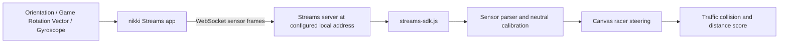

# Tilt-to-Steer Racing: Proof of Concept

## Sensor selection

For the phone setup shown in the attached image, enable **Orientation**, **Gyroscope**, and **Game Rotation Vector** in nikki Streams. Orientation alone drives steering. Game Rotation Vector and Gyroscope are diagnostic only until their axes are verified against controlled tilts. Other shown sensors are not needed for steering.

## Data flow

## Run

Enable the sensors and start streaming in the phone app. Connect both devices to the same Wi-Fi or hotspot. In the project folder run `py -m http.server 8000`, open `http://localhost:8000` on the laptop, use the same Streams server address (default `10.89.84.190:3000`), enter the session ID, and connect. Start the race, hold the phone in its steering position, and tap **Center phone / calibrate**.

## Steering mapping

The SDK callback receives JSON sensor frames. `readMotion()` traverses nested content, preferring Orientation. It treats an Orientation vector's third component as roll; named `roll` or `gamma` values are also accepted. It does not guess the axis of an unlabelled x/y/z object. Game Rotation Vector is parsed and displayed for diagnosis but is not used for steering until its axis mapping is verified against Orientation on this phone. Gyroscope values are diagnostic only; rate data is not treated as an absolute steering angle or integrated into steering. The first valid sensor frame automatically captures a neutral angle so the car does not pull when the game begins; the Center button can reset it. A small dead zone filters hand tremor, and sensitivity maps smaller tilts into progressive steering. A short time-based filter smooths noise; stale data eases back to neutral.

The Canvas loop moves the car left/right, scrolls road markings, spawns traffic, scores cars passed, and ends a run after a collision. Arrow keys and A/D are available without the phone. The expandable sensor detail area shows the actual incoming payload to help adapt parsing if the app's field names differ.
